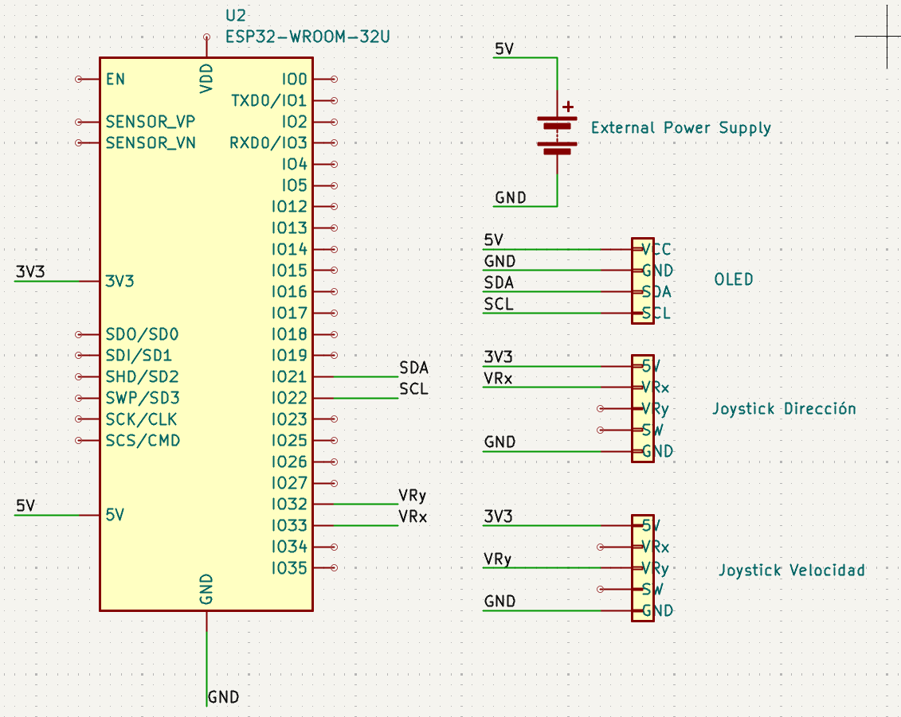
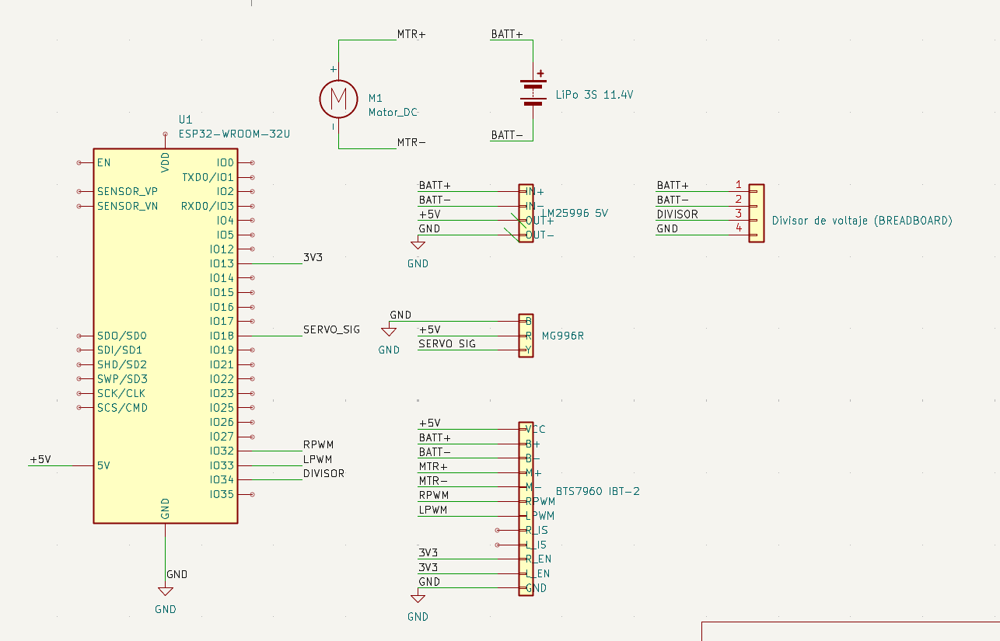

# CDIO-E7 — Auto RC con ESP32

Auto a control remoto hecho con dos placas **ESP32** que se comunican de forma inalámbrica (ESP-NOW: no necesita WiFi ni router).

| Parte | Qué hace | Código |
|---|---|---|
| **Mando** (sender) | Lee el joystick y envía las órdenes al auto. Muestra la batería del auto en una pantalla OLED. | `ESP/sender/sender.ino` |
| **Auto** (receiver) | Recibe las órdenes y mueve el motor (adelante/atrás) y el servo (dirección). Mide su batería y la envía al mando. | `ESP/receiver/receiver.ino` |

## Cómo funciona (en simple)
1. Mueves el joystick → el mando lee la posición y la envía al auto continuamente.
2. El auto convierte eso en velocidad del motor y ángulo de las ruedas.
3. El auto responde con datos (batería, potencia, estado) que aparecen en la pantalla del mando.

**Seguridad incorporada:**
- Al encender, el motor **no arranca** hasta que el acelerador esté en el centro.
- Si se pierde la señal por más de 0,5 s, el motor se **detiene** y las ruedas se enderezan.
- El motor acelera y frena de forma gradual (no de golpe).

## Ajustes del motor (archivo `ESP/receiver/receiver.ino`)
Solo hay que cambiar el número, guardar y volver a cargar el código al ESP32 del **auto**.

### 1. Potencia máxima — línea 14
```cpp
constexpr int MOTOR_MAX_POWER_PERCENT = 100;
```
- Es un porcentaje de **0 a 100**. Ejemplos: `100` = sin límite, `70` = máximo 70 %, `50` = mitad de potencia.
- Afecta igual hacia adelante y en reversa.
- El joystick sigue usando todo su recorrido: empujarlo a fondo = el límite elegido.
- Si pones un número fuera de 0–100, el código no compila (te avisa del error).

### 2. Rampas de aceleración y frenado — líneas 105 y 106
```cpp
constexpr float ACCEL_RAMP_MS = 100.0f;  // aceleración
constexpr float BRAKE_RAMP_MS = 50.0f;   // frenado
```
- Son **milisegundos** (1000 ms = 1 segundo) que tarda el motor en pasar de 0 % a 100 % de potencia (`ACCEL`) o de 100 % a 0 % (`BRAKE`).
- **Número más grande** = el auto acelera/frena más suave y lento. **Número más chico** = más brusco.
  Ejemplo: `ACCEL_RAMP_MS = 500.0f` → tarda medio segundo en llegar a potencia máxima.
- Escribir siempre con `.0f` al final (ej. `300.0f`). No usar `0`.
- Si limitaste la potencia (punto 1), llega a ese límite proporcionalmente antes (ej. al 50 % tarda la mitad del tiempo).

## Conexiones
| Mando | | Auto | |
|---|---|---|---|
| GPIO33 | Joystick X (dirección) | GPIO32 / GPIO33 | Driver motor BTS7960 RPWM / LPWM (adelante / atrás) |
| GPIO32 | Joystick Y (acelerador) | GPIO13 | Habilitar driver (R_EN y L_EN) |
| GPIO21 | OLED SDA | GPIO18 | Señal del servo |
| GPIO22 | OLED SCL | GPIO34 | Medición de batería (divisor 99,2 kΩ / 20,14 kΩ) |




Los esquemáticos completos (KiCad) están en `SCHEMATICS/`.

## Cómo cargar el código
1. Instalar **Arduino IDE** y la placa **"esp32 by Espressif Systems" versión 3.x**.
2. Instalar las librerías **Adafruit SSD1306** y **Adafruit GFX** (solo las usa el mando).
3. Placa: **ESP32 Dev Module**. Cargar `sender.ino` en el mando y `receiver.ino` en el auto.
4. Cada código tiene escrita la dirección MAC de la otra placa. Si cambias una placa, usa `Tests con ESP/MAC_tester` para leer su MAC y actualízala en el otro código.

## Carpetas
- `ESP/` — código actual del mando y del auto (`receiver_debug` es una versión antigua de pruebas).
- `Tests con ESP/` — pruebas sueltas usadas durante el desarrollo.
- `SCHEMATICS/` — esquemáticos eléctricos (KiCad).

## Versiones anteriores (git)
| Versión | Cambios |
|---|---|
| `v1` | Primera versión funcional. |
| `v2` | Nuevo protocolo de comunicación, seguridad y rampas de motor. |
| `v3` | Medición de batería y pantalla OLED en el mando. |

Para ver una versión antigua: `git show v1:ESP/receiver/receiver.ino`
